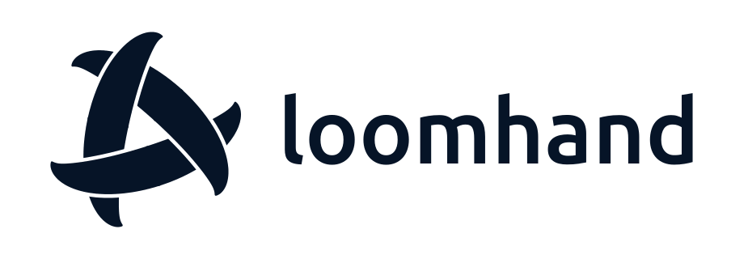

<picture><source media="(prefers-color-scheme: dark)" srcset="loomhand-logo-horizontal.svg"></picture>

Computers for AI agents. Each user gets a persistent cloud computer — a Linux desktop in a microVM — with a resident agent that any model can drive, plus a native macOS client to watch it, talk to it, and take over. Local coding agents can use the box through MCP.

**Documentation: [loomhand.github.io](https://loomhand.github.io/)**

### Projects

| Repository | Description | Docs |
|---|---|---|
| [cocoonbox](https://github.com/loomhand/cocoonbox) | The prototype — in-box agent (Rust), control plane and edge `cocoonbox-api` (Go), macOS app `CocoonBox.app` and the `cocoonbox` CLI (Swift), guest image provisioning, gRPC contracts | [docs](https://loomhand.github.io/cocoonbox/) |
| [cua](https://github.com/loomhand/cua) | Fork of [trycua/cua](https://github.com/trycua/cua) carrying Linux X11 fixes to `cua-driver`, the screen executor in the box; fixes are sent upstream | — |
| [swift-rfb](https://github.com/loomhand/swift-rfb) | Event-driven RFB/VNC client for Apple platforms with a Metal renderer | [docs](https://loomhand.github.io/swift-rfb/) |

### Built on cocoonstack

loomhand builds on [cocoonstack](https://github.com/cocoonstack) ([docs](https://cocoonstack.github.io/)). Boxes are [cocoon](https://github.com/cocoonstack/cocoon) microVMs claimed from [sandbox](https://github.com/cocoonstack/sandbox) (`sandboxd` warm pools, snapshot and clone), and model calls go through [gateway](https://github.com/cocoonstack/gateway) (`gw`). The infrastructure stays in cocoonstack; loomhand holds the product and its client-side libraries.
